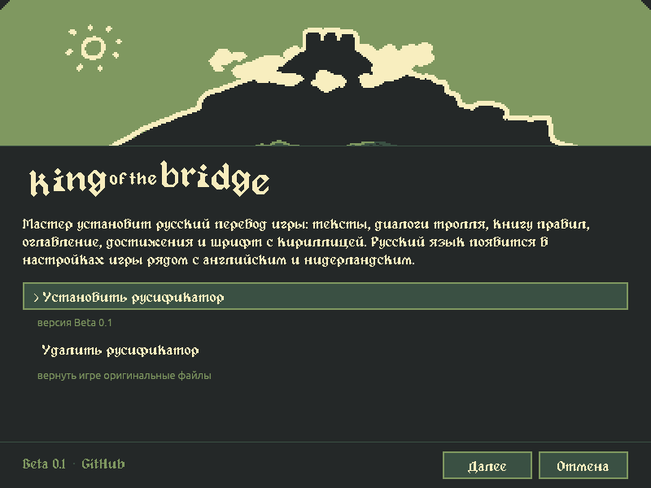
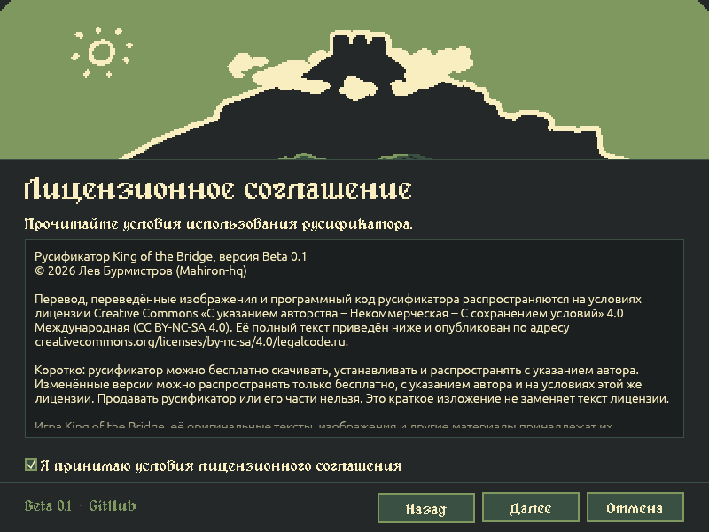
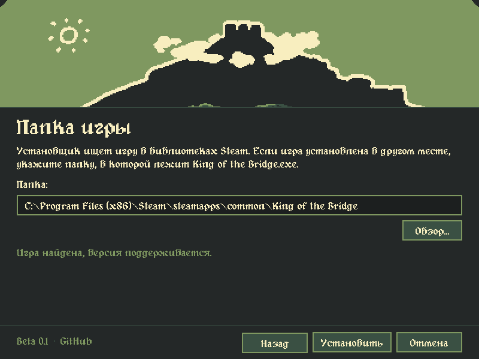
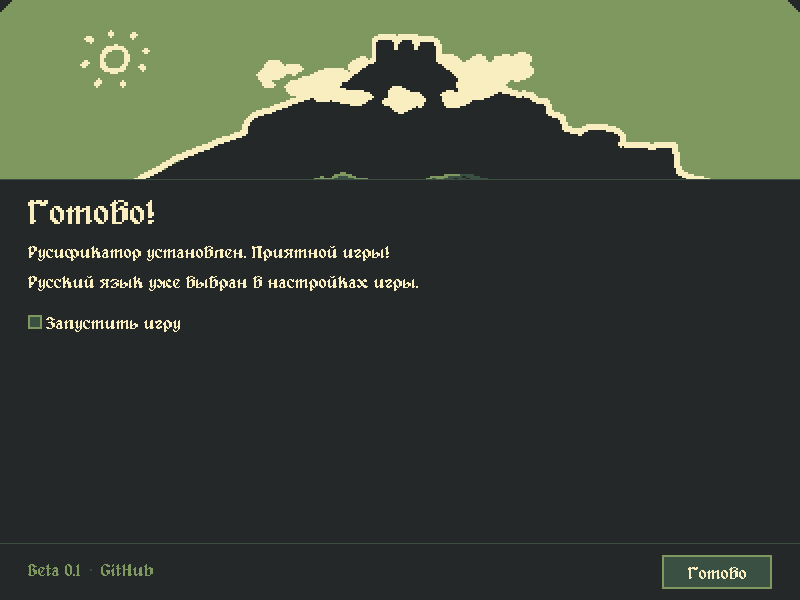
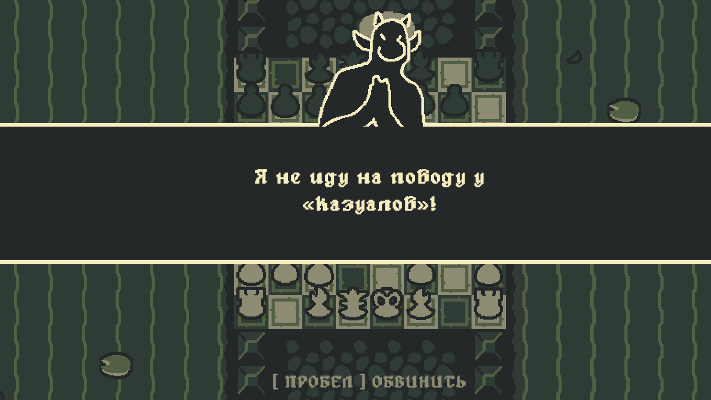
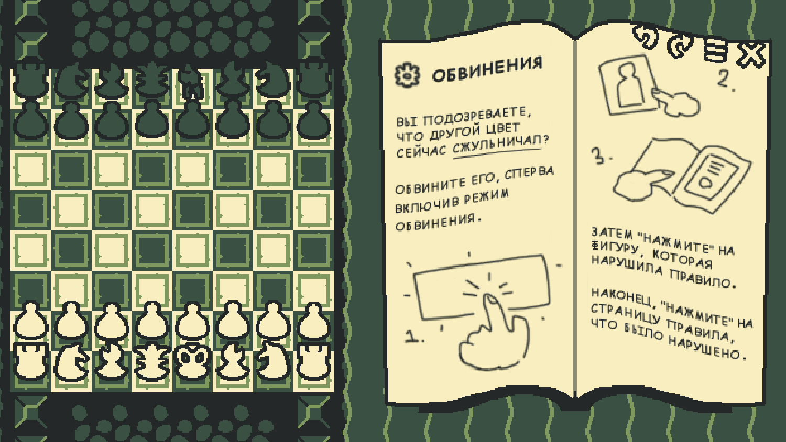
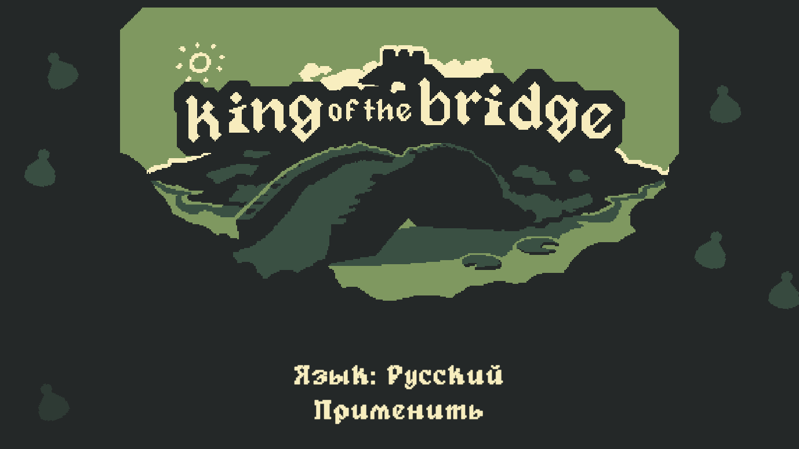
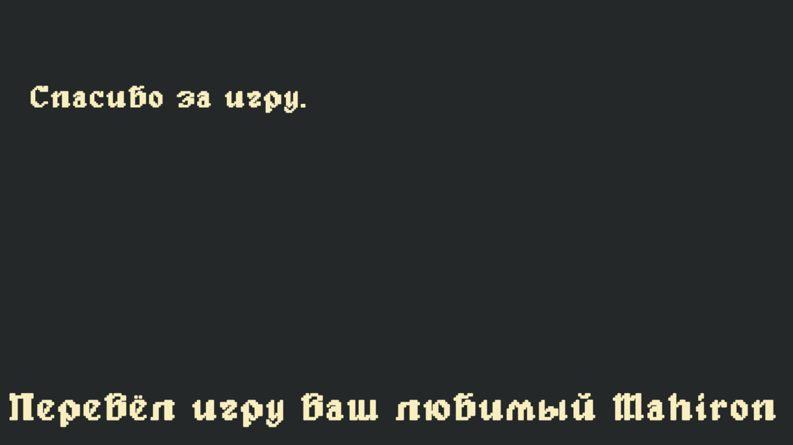

<div align="center">

# Русификатор King of the Bridge

**Русский перевод игры King of the Bridge: тексты, диалоги тролля, книга правил, достижения и шрифт с кириллицей в одном установщике**

[](https://github.com/Mahiron-hq/Russifier_King_of_the_bridge/releases)
[](LICENSE)
[](#статус)
[](#установка)
[](Cargo.toml)

</div>

---

Русификатор для игры [King of the Bridge](https://store.steampowered.com/app/2523120/) от игрока
**lion.burmistrov, он же Lev Burmistrov (он же ваш Mahiron-hq)**.

Русский язык встраивается в систему локализации самой игры и появляется в настройках третьим, рядом с
английским и нидерландским. Переключать его можно в любой момент, как и на родные языки игры. Установщик
проверяет версию игры, сохраняет оригиналы изменённых файлов и одной кнопкой возвращает всё как было.

<div align="center">

<table>
  <tr>
    <td></td>
    <td></td>
  </tr>
  <tr>
    <td></td>
    <td></td>
  </tr>
  <tr>
    <td></td>
    <td></td>
  </tr>
  <tr>
    <td></td>
    <td></td>
  </tr>
</table>

</div>

### Статус

**Beta 0.1.** Перевод закончен полностью: тексты, диалоги, книга правил вместе с оглавлением, рисованные
надписи на страницах и достижения. Бета, потому что русификатор переехал с плагина BepInEx на собственный
установщик, и этот способ установки ещё молодой. Если что-то пойдёт не так, напишите мне, ссылки
[внизу](#обратная-связь-и-ошибки).

### Что переведено

- **Все тексты игры:** диалоги тролля, меню и настройки, подсказки, нарушения правил, финальные карточки и
  титры.
- **Книга правил:** все 40 страниц, секретные страницы, оглавление с 33 кнопками и надпись «ИЛИ» на мосту.
  Рисованные от руки надписи перерисованы от руки.
- **Достижения:** названия и описания внутри игры.
- **Шрифт:** пиксельный шрифт игры с кириллицей, многоточием, кавычками-ёлочками и тире. Строки, которые
  не помещаются, уменьшаются, а не переносятся.

Все переводы собраны в одном файле: [docs/ПЕРЕВОД.md](docs/ПЕРЕВОД.md). Там же указано, что оставлено на
английском и почему.

### Возможности установщика

- **Сам находит игру** в библиотеках Steam. Если игра стоит в другом месте, папку можно указать вручную.
- **Проверяет, а не надеется.** До того как что-то менять, установщик сверяет файлы игры по SHA-256. Если
  Steam обновил игру и файлы другие, он ничего не трогает и об этом сообщает.
- **Оригиналы сохраняются** в папке `RussianMod_backup` внутри папки игры. Если запись прервётся на
  середине, установщик вернёт игру к исходному состоянию.
- **Обновляет предыдущие версии,** включая альфа-версии на BepInEx: плагин альфы удаляется, а вместе с ним и
  BepInEx, если других модов в нём нет.
- **Сразу выбирает русский язык** в настройках игры, отдельно ничего включать не нужно.
- **Удаление возвращает игру к оригиналу** язык в настройках также переключает на английский.
- **Работает без интернета** и ничего никуда не отправляет.

### Установка

Нужны Windows 10 или 11 (64-бит) и King of the Bridge из Steam. Больше ничего ставить не нужно.

1. **Скачайте установщик** `KotB_Russian_Beta_0.1.exe` на странице
   [релизов](https://github.com/Mahiron-hq/Russifier_King_of_the_bridge/releases). Берите самый верхний релиз
   и именно файл `.exe`, а не `Source code`.

2. **Закройте игру и запустите установщик.** Установщик не подписан платным сертификатом, поэтому Windows
   может показать окно «Windows защитил ваш компьютер». Нажмите **«Подробнее»**, затем
   **«Выполнить в любом случае»**.

3. **Выберите «Установить русификатор»,** примите лицензионное соглашение и проверьте папку игры.
   Обычный путь для Steam:

   ```
   C:\Program Files (x86)\Steam\steamapps\common\King of the Bridge
   ```

4. **Нажмите «Установить»** и дождитесь надписи «Готово!».

5. **Запустите игру.** Русский язык уже выбран. Сменить язык можно в игре: «Настройки» → «Текст» → «Язык».

Если установщик пишет «Нет прав на запись», игра стоит в защищённой папке. Запустите установщик от имени
администратора.

Подробная инструкция с картинками есть в
[руководстве Steam](https://steamcommunity.com/sharedfiles/filedetails/?id=3662724406).

#### Обновление

Скачайте новую версию и запустите её так же, как при установке: установщик сам заменит старую версию.
Альфа-версии 0.1–0.3 на BepInEx он тоже уберёт сам, удалять их вручную не нужно.

Если игра обновилась в Steam, а установщик пишет, что файл не совпадает ни с одной известной версией,
значит, нужна новая версия русификатора (если её нет, значит я либо этого не увидел и вы можете мне напомнить, либо я уже этим занимаюсь).

#### Удаление

Запустите установщик и выберите **«Удалить русификатор»**. Файлы игры вернутся к оригиналу, папка
`RussianMod_backup` удалится, язык переключится на английский. Не удаляйте `RussianMod_backup` вручную,
пока русификатор установлен: в ней лежат оригиналы.

#### Что меняется в папке игры

| Файл | Что с ним происходит |
|---|---|
| `King of the Bridge_Data/StreamingAssets/aa/catalog.json` | изменяется: в каталог добавляется русский язык |
| `King of the Bridge_Data/sharedassets0.assets` | изменяется: «Русский» в списке языков, кириллица в шрифте |
| `King of the Bridge_Data/Managed/Assembly-CSharp.dll` | изменяется: вызовы `KotbRussian.dll` |
| `King of the Bridge_Data/Managed/KotbRussian.dll` | добавляется: склонения, подгонка строк, оглавление, подпись в титрах |
| `King of the Bridge_Data/StreamingAssets/aa/StandaloneWindows64/localization-*-russian(ru)*` | добавляются: 4 файла с русскими таблицами и страницами книги |
| `King of the Bridge_Data/StreamingAssets/ru/` | добавляется: спрайты оглавления и моста, тексты достижений |
| `RussianMod_backup/` | добавляется: оригиналы изменённых файлов и запись об установке |

### Как это устроено

Русификатор собирается из файлов самой игры. В репозитории и в установщике нет ни одного файла игры
целиком: установщик хранит только разницу между оригиналом и переведённой версией.

```
 translations/, assets/              переводы, страницы книги, спрайты, шрифт
   │ tools/build_mod.py (UnityPy)
 переведённая копия игры             русская локаль в Addressables, таблицы, текстуры, шрифт
   │ mod/KotbPatcher (Mono.Cecil)    вызовы KotbRussian.dll в коде игры
   │ build-payload (Rust)
 payload.tar                         bsdiff-патчи и SHA-256 каждого файла
   │ installer (Rust, egui)
 KotB_Russian_Beta_0.1.exe           проверка, резервные копии, установка и откат
```

| Что | Где | Зачем |
|---|---|---|
| `translations/ru.json` | тексты | таблицы локализации, склонения, род фигур, достижения |
| `translations/images.json` | тексты на картинках | что написано на каждой странице и кнопке, для `docs/ПЕРЕВОД.md` |
| `assets/pages_ru` | 40 страниц книги правил | переведённые текстуры страниц |
| `assets/sprites_ru` | оглавление и мост | подписи 33 кнопок оглавления и надпись «ИЛИ» |
| `assets/fonts` | шрифты | `alagard-unicode-tmp` с кириллицей, `BubbleSans-Regular.otf` для надписей на страницах |
| `mod/KotbRussian` | C#, netstandard2.1 | склонения, подгонка строк, замена спрайтов, подпись в титрах |
| `mod/KotbPatcher` | C#, Mono.Cecil | вписывает вызовы `KotbRussian.dll` в `Assembly-CSharp.dll` |
| `tools` | Python | сборка мода, шрифтов, иконки, оглавления и `docs/ПЕРЕВОД.md` |
| `patchset` | Rust | формат патча, проверка версии игры, установка, удаление, откат |
| `installer` | Rust, egui | окно установщика в стиле игры |
| `scripts/build.ps1` | PowerShell | полная сборка установщика из установленной игры |

### Обратная связь и ошибки

Если вы нашли ошибку в переводе, у вас не получается установить русификатор или вы перевели бы
какую-то фразу иначе, напишите мне в телеграм-чате:
[t.me/lion_burmistrov/5](https://t.me/lion_burmistrov/5), или откройте
[issue](https://github.com/Mahiron-hq/Russifier_King_of_the_bridge/issues). Я с радостью прочитаю ваши
сообщения и внесу изменения.

### Лицензия

Русификатор распространяется на условиях
**[Creative Commons Attribution-NonCommercial-ShareAlike 4.0 International](LICENSE)** (CC BY-NC-SA 4.0).
Его можно бесплатно распространять и изменять с указанием автора и на условиях этой же лицензии,
продавать нельзя. Альфа-версии 0.1–0.3 остаются под лицензией Apache 2.0, их код хранится в ветке
[`alpha`](https://github.com/Mahiron-hq/Russifier_King_of_the_bridge/tree/alpha).

Русификатор неофициальный и не связан с разработчиком игры. Игра King of the Bridge, её оригинальные
тексты и графика принадлежат их правообладателям. Шрифты и библиотеки распространяются на условиях их
авторов, список приведён в [NOTICE](NOTICE).

Copyright © 2026 Lev Burmistrov (Mahiron-hq)
